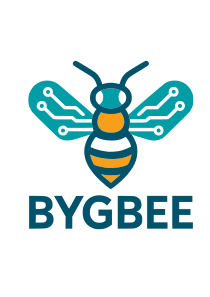

# BYGBee

Apiculteur amateur passionné.

## À propos

Mes ruches sont installées à Nalinnes dans un environnement favorable à la biodiversité et au bien-être des abeilles.

## Mes miels

- Miel de printemps
- Miel d'été

## Contact

📧 bygbee@proton.me

---

Merci de votre visite 🍯🐝
